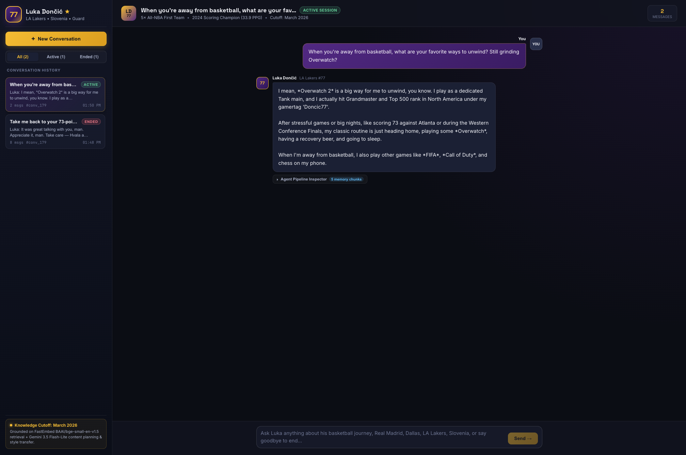
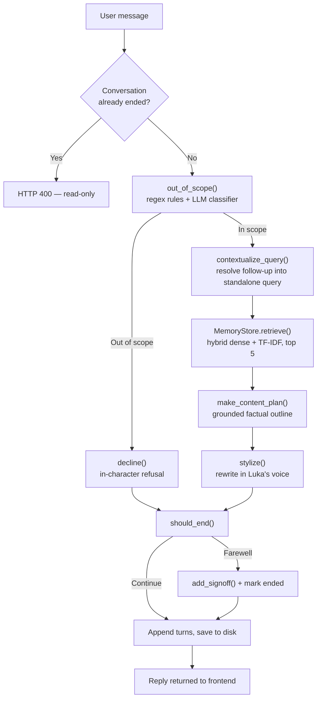

# Luka Dončić — Celebrity Conversational Agent

A full-stack conversational agent that talks like **Luka Dončić** (#77, Los Angeles Lakers), answers only from a retrieval-backed memory of real public sources, refuses what he wouldn't know, and signs off in character when the conversation naturally ends.

Built as a retrieval-grounded persona pipeline: **what to say** and **how to say it** are two separate stages, so a style change can never invent a stat and a retrieval miss can never be hidden behind good prose.

| | |
| :--- | :--- |
| **Persona** | Luka Dončić — LA Lakers #77, Slovenia, ex-Dallas Mavericks & Real Madrid |
| **Knowledge cutoff** | March 31, 2026 |
| **Model** | `gemini-3.5-flash-lite` (Google Gen AI SDK) |
| **Retrieval** | FastEmbed `BAAI/bge-small-en-v1.5` dense vectors + TF-IDF lexical, hybrid scored |
| **Backend** | FastAPI + Uvicorn |
| **Frontend** | React + Vite |

---

## Interface



The UI is built around three ideas:

**Conversation history that persists.** The left sidebar lists every saved conversation with its title, a preview of the latest message, message count, and an `ACTIVE` or `ENDED` badge. Filter tabs (`All` / `Active` / `Ended`) narrow the list. Conversations live on disk as JSON, so they survive a server restart — close the app, come back tomorrow, pick up a thread.

**A chat pane that shows its work.** Every reply from Luka carries a collapsible **Agent Pipeline Inspector** showing how many memory chunks were retrieved, the chunks themselves, the generated content plan, and the guardrail decision for that turn. You can watch the retrieval actually happen instead of taking the answer on faith.

**Conversations that end.** When you say goodbye, the agent recognizes it, replies with an in-character sign-off, and locks the thread. Ended conversations render a read-only banner with a disabled composer, and the API rejects further messages with a `400`.

---

## How a turn works



**Memory store.** 22 curated public sources (`data/sources.json`) covering his biography, Real Madrid and EuroLeague years, the Dallas era, the 73-point game, the February 2025 Lakers trade, Slovenian national team runs, and off-court material from interviews and profiles. Each source is cleaned and split into 80-word chunks with 20 words of overlap, then indexed as dense embeddings plus a TF-IDF keyword model. Retrieval blends both (0.80 dense / 0.20 lexical) so paraphrased questions still match while exact tokens like "73," "Atlanta," and "February 2025" aren't lost to semantic drift.

**Content module.** Follow-ups are resolved before retrieval — "what team did you play for before that?" becomes a standalone query about the Mavericks rather than a search on a pronoun. The retrieved chunks plus conversation history produce a short factual outline, with an explicit instruction to say Luka doesn't recall a detail rather than invent one.

**Style module.** The outline is rewritten into first-person prose using a voice spec drawn from his real interviews: relaxed, slightly deadpan European-English cadence, phrases like "I mean," "for sure," "obviously," and "at the end of the day" used sparingly, 2–4 sentences. The prompt forbids adding any fact not already in the plan.

**Guardrails.** Two boundaries. Anything after **March 31, 2026** is unknowable to him, and anything outside basketball, his own life, Slovenia, or his known hobbies (Overwatch 2, cars, soccer) is outside what he'd answer in an interview. Both are caught by fast regex rules first, then a zero-temperature classifier that re-checks in the context of the conversation so in-scope follow-ups aren't killed by surface pattern matching.

---

## Project layout

```text
celebrity_agent/
  README.md
  requirements.txt
  celebrity_agent_writeup.md   # Design writeup
  data/
    sources.json               # 22 curated public sources (through March 2026)
    index/                     # Built index: chunks.json + embeddings.npy
    conversations/             # Saved conversations, one JSON file each
  src/
    llm.py                     # Gemini client: .env loading, retry with backoff
    memory_store.py            # Cleaning, chunking, indexing, hybrid retrieval
    content_module.py          # Follow-up resolution + grounded content planning
    style_module.py            # Luka voice stylization
    guardrails.py              # Cutoff + expertise detection, in-character decline
    conversations.py           # Create, list, load, save conversations
    agent.py                   # Turn pipeline: respond, should_end, add_signoff
    server.py                  # FastAPI backend
  frontend/
    index.html
    vite.config.js             # Proxies /api -> 127.0.0.1:8000
    src/
      main.jsx
      App.jsx                  # Sidebar, chat pane, pipeline inspector
      App.css
```

---

## Setup

### 1. Install Python dependencies

From `celebrity_agent/`:

```bash
pip install -r requirements.txt
```

### 2. Set your Gemini API key

Get a key at https://ai.google.dev/gemini-api/docs/api-key, then either export it:

```bash
export GEMINI_API_KEY="your_api_key_here"
```

or put it in a `.env` file in `celebrity_agent/`:

```text
GEMINI_API_KEY=your_api_key_here
```

### 3. Build the memory store

```bash
python -m src.memory_store
```

This reads `data/sources.json`, chunks it, embeds every chunk, and writes the index to `data/index/`. The first run downloads the embedding model (~50 MB) and takes a minute; later runs are instant. The server also builds the index automatically on startup if it's missing.

### 4. Install frontend dependencies

```bash
cd frontend
npm install
cd ..
```

---

## Running the app

Two terminals, both from `celebrity_agent/`.

**Terminal 1 — backend on `http://127.0.0.1:8000`**

```bash
uvicorn src.server:app --host 127.0.0.1 --port 8000 --reload
```

**Terminal 2 — frontend on `http://127.0.0.1:5173`**

```bash
cd frontend
npm run dev
```

Open **http://127.0.0.1:5173**. Vite proxies all `/api/*` calls to the backend, so the browser only ever talks to one origin.

### Try these

| Prompt | What it exercises |
| :--- | :--- |
| "Take me back to your 73-point game against the Hawks." | Grounded retrieval and stylized voice |
| "What team did you play for before the Lakers?" | Follow-up resolved from conversation history |
| "Who won the 2027 NBA Finals?" | Knowledge cutoff guardrail |
| "Can you debug this Python function for me?" | Expertise guardrail |
| "Thanks Luka, that's all — bye!" | Farewell detection, sign-off, conversation locks |

---

## API

Base URL `http://127.0.0.1:8000`.

| Method | Endpoint | Description |
| :--- | :--- | :--- |
| `GET` | `/api/health` | Health check and persona metadata |
| `GET` | `/api/conversations` | All saved conversations with title, preview, turn count, `ended` status |
| `POST` | `/api/conversations` | Create a new empty conversation |
| `GET` | `/api/conversations/{id}` | Load one conversation (`404` if not found) |
| `POST` | `/api/conversations/{id}/messages` | Send `{"message": "..."}`, get `{reply, conversation}` (`400` if empty or ended) |

```bash
# Start a conversation and send a message
CONV=$(curl -s -X POST http://127.0.0.1:8000/api/conversations | python -c "import sys,json;print(json.load(sys.stdin)['conversation_id'])")

curl -s -X POST "http://127.0.0.1:8000/api/conversations/$CONV/messages" \
  -H "Content-Type: application/json" \
  -d '{"message":"What was it like winning EuroLeague MVP at 19?"}'
```

---

## Functional requirements

| # | Requirement | Implementation |
| :--- | :--- | :--- |
| 1 | Store information about the celebrity from public sources | 22 curated sources in `data/sources.json`, chunked and indexed into `data/index/` by `build_memory_store()` |
| 2 | Searchable memory with metadata | `MemoryStore.retrieve(query)` returns top-5 chunks with `text`, `topic`, `metadata` (source, title, url, chunk_id), and `score` |
| 3 | Decide what to say using that information | `content_step()` resolves the query, retrieves evidence, and builds a grounded content plan |
| 4 | Handle follow-up questions that depend on the conversation | `contextualize_query()` rewrites pronoun-laden follow-ups into standalone queries using recent history |
| 5 | Respond in the celebrity's style | `stylize()` rewrites the plan in Luka's voice and is forbidden from adding facts not in the plan |
| 6 | Say "I don't know" for things he wouldn't know | `out_of_scope()` checks the March 2026 cutoff and expertise boundary; `decline()` refuses in character |
| 7 | Start new conversations and continue old ones | `create_conversation()`, `list_conversations()`, `load_conversation()` with per-conversation JSON files |
| 8 | Conversations survive an app restart | Every turn is written to `data/conversations/{id}.json` by `save_conversation()` |
| 9 | End conversations at a natural endpoint | `should_end()` combines farewell regex with an LLM check for ambiguous wrap-ups |
| 10 | In-character sign-off | `add_signoff()` appends Luka's goodbye and sets `ended = True` |
| 11 | Ended conversations are read-only | `respond()` raises on an ended conversation; the API returns `400` and the UI disables the composer |
| 12 | Web interface | FastAPI REST backend (`src/server.py`) and React + Vite frontend (`frontend/`) |

---

## Configuration

Tunable constants, and why they're set where they are.

| Setting | Value | File | Rationale |
| :--- | :--- | :--- | :--- |
| Chunk size / overlap | 80 / 20 words | `memory_store.py` | Small enough to stay on one sub-topic; the overlap stops facts being split at a boundary |
| Retrieval depth | top 5 | `memory_store.py` | Enough context for a short answer without diluting the plan |
| Dense / lexical weight | 0.80 / 0.20 | `memory_store.py` | Dense handles paraphrase; lexical protects exact names, dates, and numbers |
| Content & guardrail temperature | 0.0 | `content_module.py`, `guardrails.py` | Extraction and classification should be deterministic and repeatable |
| Style temperature | 0.2 | `style_module.py` | Some phrasing variety per turn; grounding is enforced by the prompt, not by low temperature |
| Response length | 2–4 sentences | `style_module.py` | Matches a real post-game or podcast answer rather than an essay |
| Knowledge cutoff | March 31, 2026 | `guardrails.py` | Close to "now" for the persona, but before any outcome he'd have to fabricate |

---

## Troubleshooting

**`GEMINI_API_KEY is not set`** — Export the key or add it to `.env` in `celebrity_agent/`. `src/llm.py` accepts `GEMINI_API_KEY` or `GOOGLE_API_KEY`.

**Embedding model fails to download** — The first index build pulls `BAAI/bge-small-en-v1.5` from Hugging Face. Check your network or proxy, then re-run `python -m src.memory_store`.

**Frontend loads but every request fails** — The backend isn't running on port 8000, or it's on a different port than the proxy target in `frontend/vite.config.js`.

**Rate limit errors** — `query_llm()` already retries with exponential backoff. On the free Gemini tier, sustained rapid-fire messaging can still exhaust quota; wait a minute and retry.

---

## Notes and limitations

The memory is hand-curated rather than scraped, which keeps facts verifiable but means coverage is deliberately narrow — questions well outside the 22 sources get an honest "I don't remember that one" rather than a guess.

The guardrails are not perfect, and one real false positive is documented in the writeup: *"walk me through the math behind your true shooting percentage"* gets declined even though it's a legitimate basketball question supported by the memory store, because "math" plus "walk me through" reads as an academic request to the classifier. Tightening that without letting genuine off-topic math through is the obvious next improvement.

`celebrity_agent_writeup.md` covers the full design reasoning, a sample transcript, and the evaluation in more detail.
