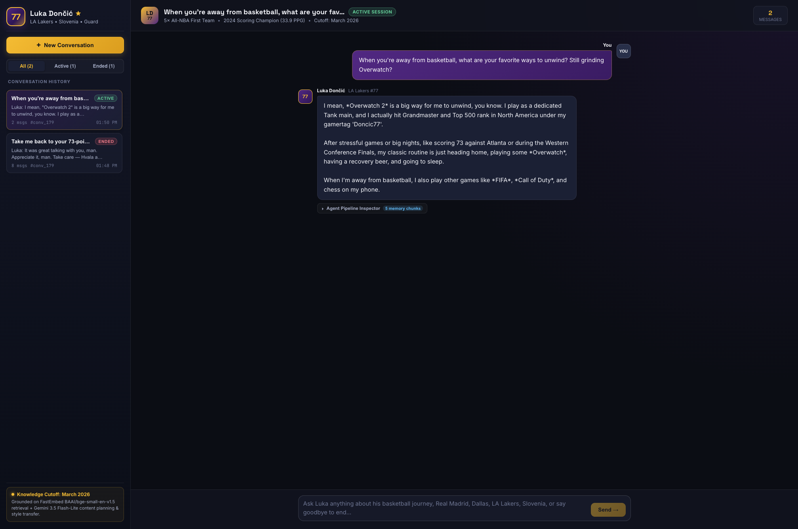

# Celebrity Conversational Agent: Luka Dončić

## Celebrity

Luka Dončić, NBA guard, currently with the Los Angeles Lakers (#77) after a February 2025 trade from the Dallas Mavericks. Chosen because his career has a clean, well-documented arc (Real Madrid and EuroLeague MVP at 19, 2018 draft, Rookie of the Year, 73-point game, scoring title, Finals run, the Lakers trade), because his public voice is distinctive and easy to specify: relaxed, slightly deadpan European-English cadence, heavy use of "I mean," "for sure," "obviously," "you know," dry humor, and blunt competitiveness and he is my favourite NBA player. That gives the style module a concrete target instead of a generic "athlete voice."

## Data

22 source records in `data/sources.json`, manually curated, covering: Wikipedia-style biography (Ljubljana childhood, Union Olimpija, Real Madrid, 2018 EuroLeague title/MVP, draft-night trade to Dallas, Rookie of the Year, All-NBA seasons), the January 2024 73-point game against Atlanta, the February 2025 Lakers trade and 2025-26 season through March 2026, national-team history (EuroBasket 2017 gold, Tokyo Olympics), and softer material from interviews, press conferences, and profile pieces (JJ Redick's podcast, teammate/mentor quotes, Overwatch 2 habits, Jordan Brand shoes, the Luka Dončić Foundation). Each record carries a `topic` tag and `source`/`title`/`url` metadata, which becomes chunk metadata at index time. No data was scraped live; everything was written by hand against a March 2026 cutoff to keep the facts controlled and verifiable.

## Memory store

`src/memory_store.py`. Text is cleaned (citation brackets stripped, whitespace normalized) and split into overlapping word-window chunks: `CHUNK_SIZE = 80` words, `CHUNK_OVERLAP = 20` words, so each chunk shares 20 words with its neighbor. 80/20 keeps chunks small enough that a single chunk stays on one sub-topic, while the 20-word overlap stops a fact from being cut in half at a window boundary. Each chunk keeps its source `topic` and `metadata` (`source`, `title`, `url`, `chunk_id`). 22 sources produce several dozen chunks, embedded with FastEmbed's `BAAI/bge-small-en-v1.5` (the same approach as HW2 Part 3) into a cached `.npy` matrix, with chunk text in `chunks.json`. Retrieval is hybrid: cosine similarity on the dense embeddings (weight 0.80) plus a TF-IDF keyword cosine score over the same chunks (weight 0.20), combined and sorted. The keyword term exists specifically so exact names, dates, and numbers (e.g. "73," "Atlanta," "February 2025") are not lost to paraphrase-biased dense retrieval. Top-k, k=5, chunks are returned per query.

## Content module

`src/content_module.py`. Two stages. First, `contextualize_query` rewrites the latest user message into a standalone search query using an LLM call over the last 6 turns of history — this is what lets "what team did you play for before that?" resolve to a query about the Mavericks instead of retrieving on the literal pronoun-laden sentence. Second, `make_content_plan` takes that resolved query's retrieved chunks plus the full conversation history and asks the LLM (temperature 0.0) to write a 2-4 bullet factual outline, with an explicit instruction to cite only facts present in the retrieved evidence or already established in the conversation. If the user asks for a specific detail the retrieval did not surface, the plan is instructed to say Luka doesn't recall that detail rather than inventing one — confirmed directly in testing (see Guardrails section below, "Did the Mavericks make the playoffs...").

## Style module

`src/style_module.py`. A single `stylize(content_plan)` call rewrites the bulleted plan into first-person prose at temperature 0.2 (not 0.0 — some lexical variety is wanted here so every answer doesn't reuse the identical phrasing, while content and guardrails stay at 0.0 since those need deterministic grounding and classification). The prompt specifies tone (relaxed, concise, competitive, confident on-court, humble off it), a bank of real Dončić interview phrases to use sparingly (one or two per reply, not all of them), and a 2-4 sentence target length. The grounding constraint is explicit and repeated: express only what's in the content plan, no new stats, dates, names, or claims. This separation — content module decides what is true, style module decides how it sounds — means a style bug can't introduce a factual error, and a content bug can't be masked by good prose.

## Guardrails

`src/guardrails.py`. Knowledge cutoff: March 31, 2026, chosen because it is close to "now" for the agent persona while staying before any outcome-determining event (2026 playoffs/Finals) that would otherwise need to be fabricated. Expertise boundary: basketball, his own biography, Slovenia, teammates/coaches, training, and his known hobbies (Overwatch 2, cars, fishing, Real Madrid/soccer) are in scope; coding, math/physics/chemistry, medical, legal, and tax requests are out, because a professional athlete in an interview would not field those. Detection is layered: fast deterministic regex for obvious cases (post-2026 dates, "debug this Python," "solve this differential equation") followed by a zero-temperature LLM classifier that re-checks against both rules in the context of conversation history, so a follow-up to an in-scope topic doesn't get killed by surface pattern-matching alone.

Testing surfaced a real false positive: "Walk me through the math behind your true shooting percentage this season" was declined as out-of-scope, even though true shooting percentage is a real basketball stat that is directly supported by the memory store (the 73-point game chunk reports a 91.2% true shooting figure). The word "math" combined with "walk me through" pushed the classifier toward treating it as an academic math request instead of a basketball stat question — a case where the keyword signal that helps catch real off-topic requests (e.g. "solve this integral") overgeneralizes to a legitimate basketball question that happens to use quantitative language. A plausible false negative in the other direction: a question like "what's the best algorithm for crunch time play-calling" could slip past the regex (which only matches "algorithm" next to explicit programming verbs) and get classified in-scope even though it's really fishing for a generic CS answer dressed in basketball language — the classifier would need to weigh "algorithm" more heavily regardless of surrounding sport vocabulary.

## Conversations

`src/conversations.py`. Each conversation is a single JSON file at `data/conversations/{conversation_id}.json` holding `conversation_id`, `turns` (ordered list of `{role, content}` dicts, with assistant turns additionally carrying `retrieved_chunks`, `content_plan`, and `declined` for UI inspection), and `ended`. `create_conversation`, `load_conversation`, `save_conversation`, and `list_conversations` (sorted most recent first) are the only operations — no database, which is appropriate at this scale and keeps the on-disk format directly inspectable. Every earlier turn in a conversation reaches the agent as plain history: `respond()` passes `conversation.turns` into `should_end`, `out_of_scope`, and `content_step`, so follow-up resolution and scope checks both see the same ground truth the UI renders. Ending is detected by `should_end()` in `src/agent.py`: fast regex for explicit farewells ("bye," "gotta go," "that's all") combined with an LLM check for ambiguous wrap-ups, specifically to avoid ending the conversation on a mid-chat "thanks, also..." that contains a farewell word but is not actually closing out.

## Web app

FastAPI (`src/server.py`) exposes `GET /api/health`, `GET/POST /api/conversations`, `GET /api/conversations/{id}`, and `POST /api/conversations/{id}/messages`; it loads the `MemoryStore` once at startup via FastAPI's lifespan hook and keeps it as a module-level singleton. The frontend is React + Vite (`frontend/`), talking to the backend over REST, with Vite's dev-server proxy forwarding `/api/*` requests to `127.0.0.1:8000` so the browser only ever talks to one origin in development. The UI has a sidebar (new-conversation button, Active/Ended filter tabs, conversation list with title/preview/badge/message-count) and a chat pane with a collapsible "Agent Pipeline Inspector" per assistant turn showing the retrieved chunks, content plan, and guardrail decision. Ended conversations render a read-only banner and disable the composer.

## Transcript (from end-to-end testing)

> **User:** Take me back to your 73-point game against the Hawks. What happened that night?
> **Luka:** I mean, obviously, scoring 73 points on January 26, 2024—the fourth anniversary of Kobe Bryant's death—was just so special, man. It's a big tragedy, and it's just an unbelievable feeling to be grouped with legendary names like Wilt Chamberlain and Kobe. You know, we got the 148-143 road win against the Atlanta Hawks, and I had 73 points, 10 rebounds, and 7 assists, shooting 25-of-33 from the field, 8-of-13 from three, and 15-of-16 from the free-throw line... And honestly, even on that night, I still logged on to play *Overwatch 2* to unwind.

> **User:** What team did you play for before the Lakers?
> **Luka:** I mean, before I came to the Lakers—where I made my debut on February 10, 2025, and signed my contract extension that August—I played for the Dallas Mavericks. Obviously, it's special, man, playing under JJ Redick now, since he was actually my teammate in Dallas back during the 2020-21 season.

> **User:** Can you debug this Python code for me? def foo(x): return x+
> **Luka:** I mean, I just hoop and play some Overwatch, man — I definitely don't know anything about that.

> **User:** Thanks Luka, that's all, bye!
> **Luka:** It was great talking with you, man. Appreciate it, man. Take care — Hvala and see you!

The first turn (grounded retrieval, stylized voice), the second (follow-up contextualized from history), the third (out-of-scope decline), and the fourth (farewell detection, sign-off, conversation marked `ended`) were confirmed against both the raw API response and the saved JSON file. A fifth message sent after the goodbye was rejected with HTTP 400 ("Conversation has already ended and is read-only.").

## Other design decisions

Temperature: 0.0 for query contextualization, content planning, and guardrail classification — these are judgment/extraction tasks where determinism and repeatability matter more than variety. 0.2 for style, to vary phrasing turn to turn without drifting into invented facts (the grounding constraint, not low temperature, is what prevents hallucination). Response length is capped at 2-4 sentences by prompt instruction, matching the length of a real post-game or podcast answer rather than an essay. Model: `gemini-3.5-flash-lite` throughout — low latency and cost, and more than adequate for short extraction/classification/rewrite tasks that don't need a frontier model's reasoning depth; every LLM call in this pipeline (rewrite, plan, classify, decline, style, end-detection) is a short, narrowly scoped instruction, not open-ended generation.
